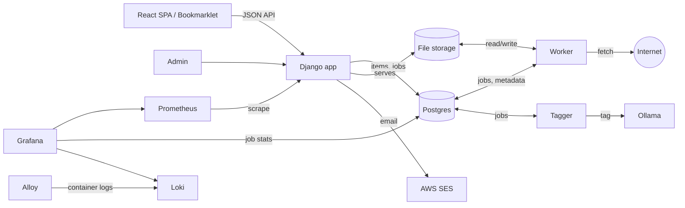

# Extended Mind — Architecture

## Flow

- Dockerised
- Python/Django service
- Worker
- Tagger: worker for model tagging jobs
- Ollama: local LLM server for tagging
- Postgres
- Local filesystem for saving files

## App

- Python 3.x, Django. Django ORM + migrations, Django admin.
- JSON API via Django Ninja.
- React SPA with vite
- Procrastinate for workers, integrated with Django

## Worker

- yt-dlp
- gallery-dl
- trafilatura
- Playwright
- ffmpeg
- exiftool
- OCR
- object detection

## Database

- Postgres 18.x

## Blob storage

- Local disk, content-addressed, dedup per user.
- DB is the index; files are never the source of truth for metadata.
- Served only through the app (auth, range requests).

## Email

- AWS SES with `django-ses`

## Admin & monitoring

- Admin panel for user management, editing static app data, and monitoring jobs
- Grafana and Prometheus for monitoring
- Loki for log aggregation
